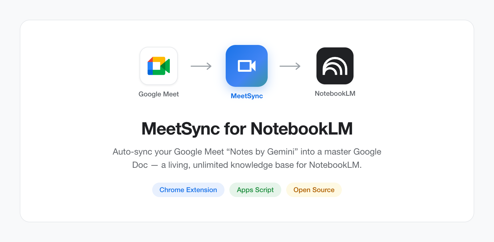

<p align="center">
  

# MeetSync

Automatically consolidate all your **Google Meet notes** into a single **Master Google Doc** — a living, unlimited knowledge base for Gemini Notebook (formerly NotebookLM) or any other AI tool.

---

## 🚀 Quick Start

### Path 1: the sync only (2 minutes, nothing to install)

1. **[Click here to make a copy of the template](https://docs.google.com/document/d/1ptU9lzwjX2LfBi_IVZeT00YCLrkmm5D25KmqeqEwB_o/copy)**
2. In your new document, refresh the page. A **🚀 NotebookLM** menu appears.
3. Run **🔄 Sync Now** and follow the authorization prompts. Google shows an "unverified app" screen because the script is your own copy: click **Advanced → Go to … (unsafe)**.
4. Run **⏰ Enable Auto-Sync**. New meeting notes are added every 15 minutes.
5. In [Gemini Notebook](https://notebook.google.com) (formerly NotebookLM), add the doc as a Google Drive source. It stays up to date on its own.

### Path 2: add the dashboard (Chrome extension)

The extension adds a popup and dashboard: sync status, history, files, analytics and settings. Do Path 1 first, then:

1. In your doc, open **Extensions → Apps Script → Deploy → New deployment → Web app**. Set **Execute as: Me** and **Who has access: Anyone**, then deploy.
2. Download `meetsync.zip` from the **[Releases page](https://github.com/benoit-prentout/meetsync/releases)**, unzip it, open `chrome://extensions`, enable **Developer mode**, click **Load unpacked** and pick the unzipped folder.
3. In your doc, open **🚀 NotebookLM → 🔌 Connect extension** and copy the code.
4. Open the extension and paste the code in the setup wizard. Then enter your Master Doc ID and Archive Folder ID in **Settings**.

> ### 🔧 Recreating the template (if the link above ever breaks)
>
> 1. Create a **new empty Google Doc** at [docs.google.com/document/create](https://docs.google.com/document/create)
> 2. Open **Extensions > Apps Script**, delete the default code, and paste the entire content of [`apps-script/Code.gs`](apps-script/Code.gs)
> 3. Name the project **"Sync NotebookLM"** and click **Save**
> 4. In the Apps Script editor, add the **Drive API** (v3) and **Docs API** (v1) via the **Services** panel (+)
> 5. Click **Deploy > New deployment > Web app**:
>    - Execute as: **Me**
>    - Who has access: **Anyone**
> 6. Copy the resulting **deployment URL** (`https://script.google.com/macros/s/{id}/exec`)
> 7. Update the link in this README (line 14 above) with the new **doc URL** + `/copy` at the end

---

## Install from Releases

See **Path 2** above. The release build ships a shared Google sign-in client, so there is nothing to create in Google Cloud. If you fork MeetSync or build from source with your own client, follow [Google Cloud Setup](docs/google-cloud-setup.md) (advanced).

To update the backend later, use **Deploy Backend** in the extension's Settings. Google shows an "unverified app" screen the first time: click **Advanced → Go to MeetSync (unsafe)**. This is expected, the extension is not verified by Google. If you prefer, paste the new `apps-script/Code.gs` into the Apps Script editor by hand and redeploy.

---

## 🏗 Why this tool?

Gemini Notebook (formerly NotebookLM) caps sources per notebook (50 on the free plan, up to 600 on Ultra) and Meet creates one doc per meeting. By grouping months of meetings into a single clean document, you stay far below the cap and any AI tool can make long-term connections.

### ✨ Features

* 👥 **Team Support**: Fetches meeting notes organized by your colleagues (files in "Shared with me", "Shared Drives", or files containing "Notes par Gemini").
* 📊 **Summary Table**: An automatically generated table at the top of your document lists all synced meetings.
* 📦 **Auto-Archiving**: Automatic archives are created monthly or when the document size reaches the limit.
* 📧 **Email Notifications**: Receive an email with the link to your new archive as soon as it is created.
* 🛡️ **Smart Sync**: Works even on files where you only have view-only access.
* ⚡ **Performance**: Uses advanced Google APIs to process 20+ meetings in seconds.
* 🔄 **Backend Auto-Deploy**: Push Code.gs updates directly from the extension Settings via the Apps Script REST API — no manual copy-paste needed.
* 📈 **Analytics Dashboard**: Multi-section insights dashboard with charts showing sync frequency, files processed, doc growth rate, success rates, and sync streaks.
* 🗃️ **Archive History**: Full history of archive events tracked and visible in the Analytics view.

---

## 🏗 How it works?

1. **Global Scan**: The script searches for Gemini note variants ("Notes de la réunion", "Meeting notes", etc.) everywhere on your Drive.
2. **Filtering**: It ignores already-synced files using an internal script database.
3. **Cleaning**: It extracts text, removes Gemini-specific metadata, and simplifies Markdown formatting.
4. **Insertion**: It adds new notes to the top of the doc and updates the summary table.
5. **Archiving**: Monthly or when full, it creates a **"Meeting Notes Archive"** and resets the master doc.

---

## 🛠 Setup Guide (Manual Install)

### 1️⃣ Prepare the Master Document
1. Create a new, empty **Google Doc** (e.g., "Master - Meeting Notes").
2. Inside this doc, go to the menu **Extensions > Apps Script**.

### 2️⃣ Copy the Code
Choose one:

**Option A — Auto-Deploy (to update an existing script)**: Complete the Chrome extension Setup wizard and enter your Script Project ID, then in Settings click **Deploy Backend**. The extension pushes the code via the Apps Script API. Google shows an "unverified app" screen the first time (**Advanced → Go to MeetSync (unsafe)**).

**Option B — Manual copy**:
1. Delete everything in the script editor.
2. Copy the entire content of `apps-script/Code.gs` and paste it into the editor.
3. Save and name the project "Sync NotebookLM".

### 3️⃣ Configure Google Services
The script needs direct access to Drive and Docs APIs.
1. In Apps Script editor, click the **+** next to **Services**.
2. Search for **Google Drive API** (v3) and click **Add**.
3. Click the **+** again, search for **Google Docs API** (v1) and click **Add**.

### 4️⃣ First Run & Authorization
1. In the top toolbar, ensure `appendMeetNotesToMaster` is selected and click **Run**.
2. An authorization window will appear: follow the prompts to **Allow** the script.
3. Go back to your Google Doc and refresh the page. A new **🚀 NotebookLM** menu will appear!

### 5️⃣ Automation (Easiest Method)
To have the sync run automatically every 15 minutes:
1. In your Google Doc, go to the menu **🚀 NotebookLM > ⏰ Enable Auto-Sync**.
2. That's it! The script will now run in the background.

---

## 📋 Daily Usage

| Option | Description |
|---|---|
| **🔄 Sync Now** | Forces an immediate sync of the latest meetings. |
| **⏰ Enable Auto-Sync** | Activates the 15-minute background synchronization. |
| **📜 View Sync History** | Displays a log of recent synchronization runs. |
| **📦 Archive Document Now** | Manually empty the master doc and create a timestamped archive. |
| **🧹 Reset Sync State** | Useful if you want to re-import everything from scratch. |
| **❓ Start Here / Help** | Shows instructions and quick tips. |

---

## 🧠 Connecting to Gemini Notebook (formerly NotebookLM)

1. Go to [Gemini Notebook](https://notebook.google.com).
2. Create a new notebook.
3. Add your **Master Google Doc** as a **Google Drive** source.
4. That's it: since May 2026, Docs sources sync from Drive automatically. To force an update, open the source and click **Click to sync with Google Drive**.
5. **Archives**: when an archive is created, add the archive file as a source too, so your full history stays available. The archive email contains the link.

---

## 💻 Development

```bash
npm run dev       # Vite dev server at localhost:5173 (chrome APIs mocked)
npm run build     # tsc + vite build → dist/
npm test          # vitest run
npm run package   # build + zip → meetsync.zip
```

Dev entry points (bypass `chrome-extension://` restrictions):

| URL | Renders |
|-----|---------|
| `/dashboard.html` | Full auth + dashboard flow (conditional mock) |
| `/dashboard-dev.html` | `<Dashboard />` directly, mocked data |
| `/popup-dev.html` | `<Popup />` directly, mocked data |
| `/wizard-dev.html` | `<SetupWizard />` with scenario picker |

Mocks live in `src/dev-mocks.ts`. Tree-shaken from production builds.

---

## 📜 License
MIT
